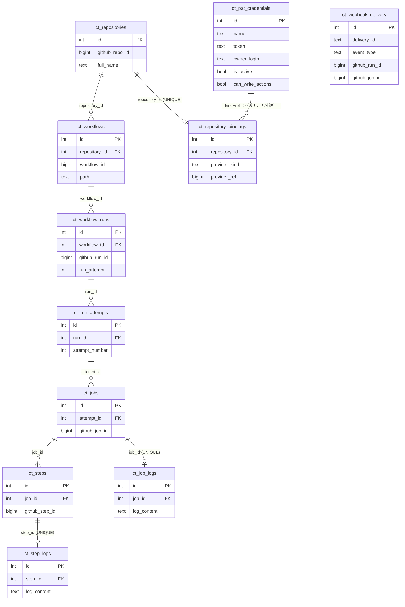

# models：实体与关联关系

本目录只放**数据模型**：表结构、领域规则和持久化行为，以及它们自己的状态语义。
import 方向只有一个——**别的层可以 import `models`，`models` 不 import 任何别的层**。

本文的关系图与关系表**逐条对应代码里的关系声明**（`models/*.py` 中的
`BelongsTo` / `HasOne` / `OrderedHasMany`），并且与 `schema/model.py` 中的外键、
唯一约束一致。核对方法见文末。

## 一、通用约定

1. **`models` 是叶子层，只依赖自己和 ORM。** 不 import 本项目的任何其他模块
   （服务层、适配器、`github`、`credentials`、`infrastructure`、`schema`）。

   ```
   服务层 / 适配器 / github / credentials / infrastructure / schema
                                  ↓
                               models
   ```

   这不是风格偏好：这一层能不能被单独读懂、单独测试、单独复用，全看它是否
   自足。由此推出三条做法：

   - 模型要用的**词汇**——状态常量、状态机、模型自己会抛的错——定义在 `models/`
     内部，不能放在别处再引回来；
   - 模型要做的**动作**——解析凭据、发 HTTP、去远端补数据——不属于模型，放在
     调用它的服务里；
   - 一个只被模型需要、却定义在别处的名字，是**那个名字放错了位置**，不是
     "模型恰好引用了它"。

   判据（必须输出 0）：

   ```powershell
   rg -n 'from \.\.(?!models)' -g '*.py' src/rhosocial/github_ci_tracker/models -P
   ```

   2026-10-29 已清零：状态机与两个模型级错误搬了进来（`states.py`、`errors.py`），
   凭据解析搬了出去（`credentials/resolver.py`）。现在上面那条命令输出 0。

2. **一个实体、一张表、两个类**：每个实体都有同步类与 `Async` 前缀的异步类，
   两者共用同一个 `__table_name__`，关系各声明一份，行为一致。
3. **关系声明在模型上**，`inverse_of` 写对端的属性名。
4. **关系注解是字符串前向引用**：目标类在另一个模块里，`models/__init__.py` 在全部
   类定义完成后调用 `_publish_relation_targets`，把每个模型发布进每个模型模块的
   globals，注解才解析得到。新增关系时不需要手工 import 对端。
5. **有序一对多用 `OrderedHasMany` / `AsyncOrderedHasMany`**（`models/relations.py`），
   它在外键过滤之外按 `order_key` 排序，批量加载时避免逐个 `await`。
6. **没有迁移**：schema 变形状即重建数据库（见 `schema/model.py` 顶部说明）。
7. **凭据由服务解析，不由模型解析。** `Repository` 上曾有 `resolve_token` /
   `require_token`，它们要问 provider 注册表，于是把 `models` 拖进了凭据层。现在这两个
   动作在 `credentials/resolver.py`，模型只保存 `ct_repository_bindings` 里的
   `(provider_kind, provider_ref)` 这一对不透明值。

## 二、实体清单

| 实体（同步 / 异步类） | 表 | 角色 |
|---|---|---|
| `Repository` / `AsyncRepository` | `ct_repositories` | 订阅的仓库，一切 CI 数据的锚点 |
| `Workflow` / `AsyncWorkflow` | `ct_workflows` | 仓库下缓存的工作流 |
| `WorkflowRun` / `AsyncWorkflowRun` | `ct_workflow_runs` | GitHub 的一次运行（重跑复用同一 run id） |
| `RunAttempt` / `AsyncRunAttempt` | `ct_run_attempts` | 该运行的第 N 次执行 |
| `Job` / `AsyncJob` | `ct_jobs` | 某次 attempt 下的一个 job |
| `Step` / `AsyncStep` | `ct_steps` | job 的步骤 |
| `StepLog` / `AsyncStepLog` | `ct_step_logs` | step 的日志（1:1，可选；只能在 run 结束后约一小时内取回，取回后长期保存） |
| `JobLog` / `AsyncJobLog` | `ct_job_logs` | job 的整篇日志（1:1，可选；step 日志缺失时的兜底） |
| `PatCredential` / `AsyncPatCredential` | `ct_pat_credentials` | 凭据本体：PAT、探测结果（provider 管生命周期，行在这里） |
| `RepositoryBinding` / `AsyncRepositoryBinding` | `ct_repository_bindings` | 仓库由哪个凭据应答（1:1，可选） |
| `WebhookDelivery` / `AsyncWebhookDelivery` | `ct_webhook_delivery` | 到达的投递证据（平行于资源状态） |

### run 的状态属于 attempt

`ct_workflow_runs` 只存 run 的身份和与执行无关的元数据（`run_number`、`branch`、
`commit_sha`、`event`、`pr_number`、`actor`、`webhook_received_at`）。**状态、结论、
起止时间属于一次执行**，只存在 `ct_run_attempts`。

run 的"当前状态"不是一列，而是查询时由数据库从最新 attempt 算出来的推导字段
（`WorkflowRun.latest_attempt` / `latest_status` / `latest_conclusion` /
`latest_started_at` / `latest_completed_at`）。这样不存在"run 与 attempt 不一致"
这种状态：同一个事实只有一份。写入路径（`adopt_from_remote` / `update_from_remote`）
写完 attempt 后把这五个值同步到内存对象，读路径用 `find_one(..., derived=True)` /
`find_all(..., derived=True)` 让数据库一次算出来。

11 张表全部有对应模型。`ct_pat_credentials` 的表定义在 `schema/model.py`
（`PAT_SCHEMA`），模型在 `models/pat_credential.py`——provider（`credentials/pat`）
持有**生命周期**（resolve / probe / rotate / deactivate），不持有存放位置。

## 三、关联关系图

只画**逻辑实体**一次（每个都有同步/异步两个类）。线上的文字是外键列名。



### "某次运行的 job"是两跳

`ct_jobs` 上没有 `run_id`（`attempt_id -> run_id` 会违反 BCNF，且两个外键可以互相
矛盾）。所以读"这次运行的 job"是 `run → attempts → jobs` 两跳，写入时 job 直接挂到
attempt 上。这是 `WorkflowRun.jobs` 不存在、只有 `jobs_of_attempt()` 的原因。

## 四、关系逐条对照

### 4.1 ORM 声明的关系

| 主体 | 属性 | 类型 | 外键列 | 对端属性（`inverse_of`） | 基数 |
|---|---|---|---|---|---|
| `Repository` | `workflows` | `OrderedHasMany[Workflow]` | `repository_id` | `repository` | 1 : N |
| `Repository` | `binding` | `HasOne[RepositoryBinding]` | `repository_id` | `repository` | 1 : 0..1 |
| `Workflow` | `repository` | `BelongsTo[Repository]` | `repository_id` | `workflows` | N : 1 |
| `Workflow` | `runs` | `OrderedHasMany[WorkflowRun]` | `workflow_id` | `workflow` | 1 : N |
| `WorkflowRun` | `workflow` | `BelongsTo[Workflow]` | `workflow_id` | `runs` | N : 1 |
| `WorkflowRun` | `attempts` | `OrderedHasMany[RunAttempt]` | `run_id` | `run` | 1 : N |
| `RunAttempt` | `run` | `BelongsTo[WorkflowRun]` | `run_id` | `attempts` | N : 1 |
| `RunAttempt` | `jobs` | `OrderedHasMany[Job]` | `attempt_id` | `attempt` | 1 : N |
| `Job` | `attempt` | `BelongsTo[RunAttempt]` | `attempt_id` | `jobs` | N : 1 |
| `Job` | `job_log` | `HasOne[JobLog]` | `job_id` | `job` | 1 : 0..1 |
| `Job` | `steps` | `OrderedHasMany[Step]` | `job_id` | `job` | 1 : N |
| `Step` | `job` | `BelongsTo[Job]` | `job_id` | `steps` | N : 1 |
| `Step` | `step_log` | `HasOne[StepLog]` | `step_id` | `step` | 1 : 0..1 |
| `StepLog` | `step` | `BelongsTo[Step]` | `step_id` | `step_log` | 1 : 1 |
| `JobLog` | `job` | `BelongsTo[Job]` | `job_id` | `job_log`（见 §6） | 1 : 1 |
| `RepositoryBinding` | `repository` | `BelongsTo[Repository]` | `repository_id` | `binding` | 1 : 1 |

排序键：

| 关系 | `order_key` | 方向 |
|---|---|---|
| `Repository.workflows` | `workflow.id` | 升序 |
| `Workflow.runs` | `run.run_number` | **降序**（最新在前） |
| `WorkflowRun.attempts` | `attempt.attempt_number` | 升序 |
| `RunAttempt.jobs` | `job.id` | 升序 |
| `Job.steps` | `step.number` | 升序 |

### 4.2 只有列、没有关系对象

| 表 | 列 | 指向 | 说明 |
|---|---|---|---|
| `ct_webhook_delivery` | `github_run_id` / `github_job_id` | 运行 / job | **故意不建外键**：签名失败或外来投递没有对应行 |
| `ct_repository_bindings` | `provider_kind` + `provider_ref` | provider 自己的表（今天 `ct_pat_credentials.id`） | **多态引用，故意不建外键**：core 不认识任何 provider 的表 |

## 五、唯一约束决定"1:1 还是 1:N"

| 表 | 唯一约束 | 效果 |
|---|---|---|
| `ct_workflows` | `(repository_id, workflow_id)` | 同一仓库内工作流唯一 |
| `ct_workflow_runs` | `(workflow_id, github_run_id)` | 同一工作流内 run 唯一 |
| `ct_run_attempts` | `(run_id, attempt_number)` | 重跑是同一 run 的第 N 行，不是新 run |
| `ct_jobs` | `(attempt_id, github_job_id)` | job id 全局唯一，attempt 内再限一次 |
| `ct_steps` | `(job_id, github_step_id)` | 步骤按 job 唯一 |
| `ct_step_logs` | `step_id` **UNIQUE** | step 日志的 1:1；"没采集到"是**没有行**，不是可空列 |
| `ct_job_logs` | `job_id` **UNIQUE** | job 日志的 1:1；"没有日志"是**没有行**，不是可空列 |
| `ct_repository_bindings` | `repository_id` **UNIQUE** | 一个仓库只能有一个凭据应答 |

## 六、没有"job step"这个实体

GitHub **没有 per-step 日志端点**（在可测仓库上全是 404），但 run 级归档
（`GET /actions/runs/{id}/logs`）在 **run 结束后约一小时**内是“一 step 一个文件”
（`<job 名>/<step 号>_<step 名>.txt`），之后被压平成“一 job 一个文件”，step 边界
**不可恢复**。这一小时是**取回的截止时间**，不是保存期限：写进 `ct_step_logs` 的行
和别的表一样长期存在，读它时没有任何窗口判断。因此：

- `ct_step_logs`（`StepLog`）记录截止时间之前取回的 step 文本，与 step 1:1，**允许缺失**；
- `ct_job_logs`（`JobLog`）保留合并文本作兜底：没赶上取回、漏采，或调用方要整个 job；
  它的**来源不变**——仍是 `GET /actions/jobs/{job_id}/logs`（实测与归档里的合并文件
  逐字节相同），归档只为 step 分片而拉；
- runner 的 `system.txt`（`Requested labels` / `Job defined at` / 等待 runner 的记录）
  **不入库**——它是调度日志，不是 step 的输出；
- 缺行是答案（“没赶上采集”），不是可以一直重试的 cache miss；读路径必须退回 job 日志。
  缺行只说明当时没取回，不代表这张表有时效。
- **尽力而为**：一个 job 的 step 全都没有日志时，调用方读该 job 的合并日志自行分析；
  部分有、部分没有时，只返回有行的那几段，并列出缺失的 step 号。

没有 `ct_job_steps` 这种表：step 的**状态**从来不是单独推送的，它搭载在 job 的载荷里：

```
webhook workflow_job → payload.workflow_job.steps[]   （推送通道）
GET /actions/runs/{run_id}/jobs → jobs[].steps[]       （拉取通道）
        ↓
Job.upsert_from_remote 级联 → Step.upsert_from_remote（按 (job_id, number) 落库）
```

## 七、曾有的不一致（已修正）

两处文档漂移在 2026-10-29 修正：

1. `JobLog.job` 的 `inverse_of` 曾写成 `"log"`，而对端属性是 `job_log`。现两端
   （同步与异步双胞胎）均为 `inverse_of="job_log"`，注释里的 `:attr:`Job.log`` /
   `:attr:`AsyncJob.log`` 也一并改为 `job_log`。
2. `schema/model.py` 中 `ct_jobs` 的注释曾写 "see ``WorkflowRun.jobs``"，该属性
   不存在，已改为 ``WorkflowRun.jobs_of_attempt``。

## 八、如何核对本文

```powershell
# 关系声明（应覆盖 §4.1 的每一行）
rg -n 'ClassVar\[(Async)?(HasOne|HasMany|BelongsTo)|= (Async)?(HasOne|HasMany|BelongsTo|OrderedHasMany)\(' src/rhosocial/github_ci_tracker/models

# 表名与类名（应覆盖 §2）
rg -n '__table_name__|^class ' src/rhosocial/github_ci_tracker/models

# 外键、唯一约束与删除行为（应覆盖 §5）
rg -n 'name="ct_|foreign_keys=|unique_constraints=' src/rhosocial/github_ci_tracker/schema/model.py

# 叶子层：不得从本项目其他模块 import（必须输出 0，见 §一.1）
rg -n 'from \.\.(?!models)' -g '*.py' src/rhosocial/github_ci_tracker/models -P
```
